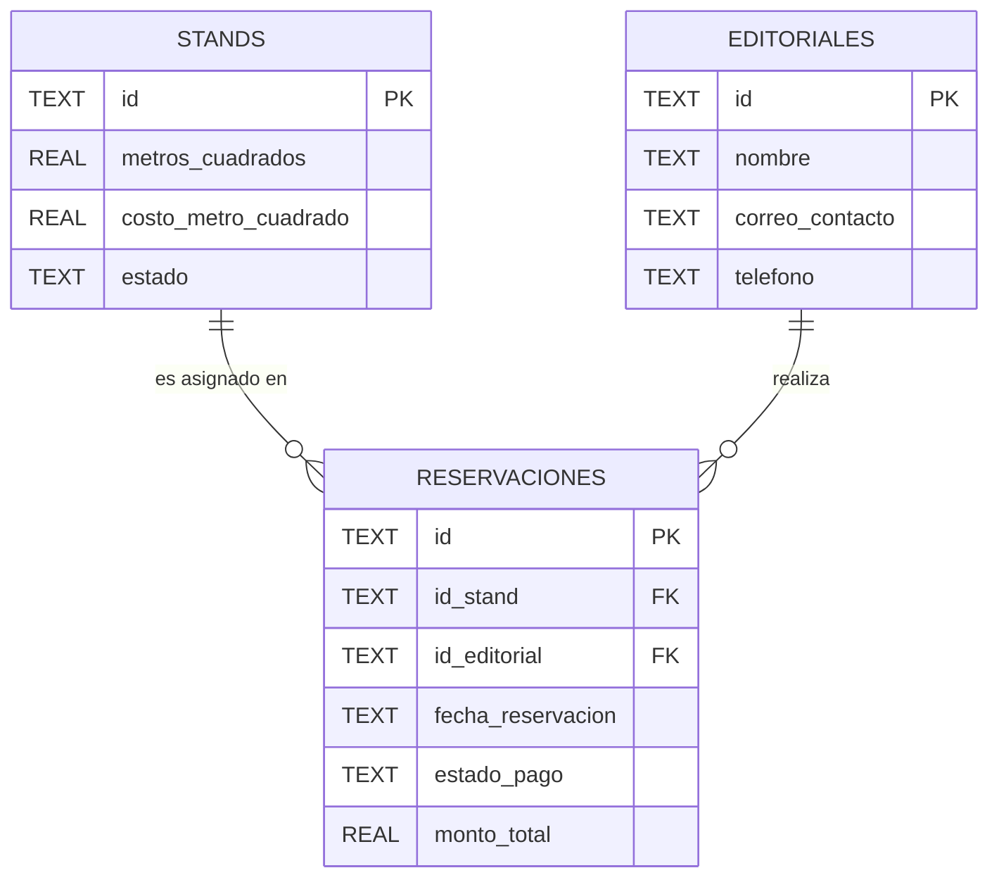

# Diagrama Entidad-Relación (Base de Datos SQLite)

El modelo relacional implementado en `feria_stands.db` consta de tres tablas principales. Un **Stand** puede estar asignado a múltiples registros de reservación a lo largo del tiempo, y una **Editorial** puede realizar una o varias **Reservaciones**, vinculándose mediante llaves foráneas (`id_stand` e `id_editorial`).

## Diccionario de Tablas

### 1. Tabla `stands`

| Campo | Tipo de Dato | Restricción | Descripción |
| :--- | :--- | :--- | :--- |
| `id` | TEXT | PRIMARY KEY | Identificador único del stand (ej. `ST-01`) |
| `metros_cuadrados` | REAL | NOT NULL | Superficie física del stand en metros cuadrados |
| `costo_metro_cuadrado` | REAL | NOT NULL | Tarifa aplicada por cada metro cuadrado |
| `estado` | TEXT | NOT NULL | Estado actual (`DISPONIBLE`, `RESERVADO`, `OCUPADO`, `BLOQUEADO`) |

### 2. Tabla `editoriales`

| Campo | Tipo de Dato | Restricción | Descripción |
| :--- | :--- | :--- | :--- |
| `id` | TEXT | PRIMARY KEY | Identificador único de la editorial (ej. `ED-01`) |
| `nombre` | TEXT | NOT NULL | Nombre comercial o razón social de la editorial |
| `correo_contacto` | TEXT | NOT NULL | Correo electrónico de contacto |
| `telefono` | TEXT | NOT NULL | Número telefónico de contacto |

### 3. Tabla `reservaciones`

| Campo | Tipo de Dato | Restricción | Descripción |
| :--- | :--- | :--- | :--- |
| `id` | TEXT | PRIMARY KEY | Identificador único de la reservación (ej. `RES-01`) |
| `id_stand` | TEXT | FOREIGN KEY | Referencia a `stands(id)` |
| `id_editorial` | TEXT | FOREIGN KEY | Referencia a `editoriales(id)` |
| `fecha_reservacion` | TEXT | NOT NULL | Fecha de registro en formato `YYYY-MM-DD` |
| `estado_pago` | TEXT | NOT NULL | Estado del pago (`PAGADO` o `PENDIENTE`) |
| `monto_total` | REAL | NOT NULL | Importe total calculado del stand reservado |