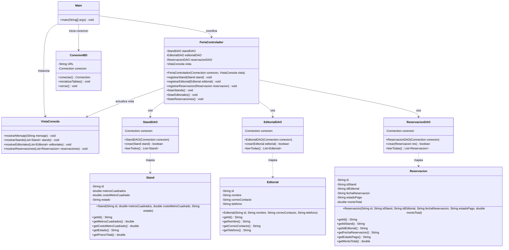

# Diagrama de Clases (Patrón MVC + Capa BD)

El siguiente diagrama representa la estructura orientada a objetos del sistema, mostrando en bloques visuales las clases de las capas **Modelo**, **Vista**, **Controlador** y **Base de Datos (DAO)**, así como sus relaciones de dependencia y asociación.

